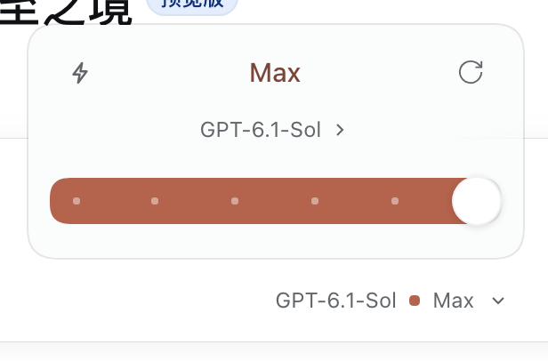
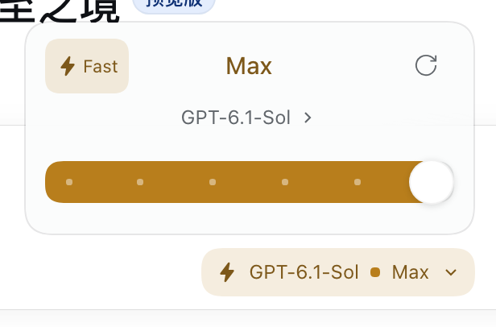

# Model Controls for DeepSeek Harness

用同一个紧凑浮层管理模型、推理等级和 Fast，替代宿主原来的模型选择器。Fast 只对 GPT 模型出现；开启后整块控件从彩色切换为金色。





每个推理等级有自己的颜色：Default 灰、Low 蓝、Medium 青、High 绿、Xhigh 琥珀、Max 陶土，等级标题、滑杆和输入框胶囊上的小圆点同步变色。Fast 开启后改用由浅到深的金色梯度，仍然能看出档位差别。

浮层顶部是当前推理等级，左侧是 Fast，右侧是重置；中间一行切换模型；底部是按档位的推理强度滑杆。点击输入框里的胶囊重新打开，`Esc` 关闭并把焦点还给胶囊。

也支持 `/fast`、`/fast on`、`/fast off` 和 `/fast status`。Fast 按会话保存，新会话默认关闭。

## 安装

把本目录作为本地插件安装到 DSH desktop profile，再启用 `dsh-codex-fast`。插件组合包只插入自己的 `codex-fast` 条目。

保留原 `llm-pi-ai` 插件和 `config.providers`。Magpie 继续维护原来的模型列表、连接地址和默认模型；不需要迁移 provider，不修改 DSH 或 Magpie 的程序文件。

要求 DSH 0.2.x、Node.js 22.19 或更新版本，以及宿主提供的 Loader、Storage Domain、Commands、Session Controller、Connection、模型目录和 UI 槽位接口。

## 界面接入

客户端用公开的 `conversation.input.model` 单槽注册自己的控件，`priority: -1` 低于原选择器的 0，因此遮蔽原控件；插件卸载后原选择器自动恢复。模型目录直接复用 `ctx.modelDirectories.directoryFor(sessionId)`，与 `/model` 共用同一份目录、同一套 `select` 语义，因此不会出现两个入口显示不同选择的情况。

浮层使用宿主的 `MenuSurface`、`useAnchoredPosition` 和 `useDismissOnOutsidePointer`：底色、圆角、阴影跟随当前主题，位置限制在视口内。推理档位来自模型目录的 `reasoning.efforts`，档位 ID 作为不透明字符串传回宿主；没有默认档位的模型额外提供 Provider Default。

插件的显示名来自 `locale/en.json` 与 `locale/zh.json` 的 `meta.title`（Model Controls / 模型控制）。包名、Loader 条目和 `codex_fast` 存储域保持不变。

## 请求范围

插件在自身生命周期内包装宿主的 `fetch`，只处理同时满足以下条件的请求：

- 目标与原适配器配置中的 OpenAI Chat Completions 或 Responses 端点完全匹配。
- 模型 ID 属于 GPT，包括 Codex、WorkBuddy、远程 Magpie 和分组路由中的 GPT。
- 请求来自 DSH 公开的 `llm/stream` 中间件；插件通过独立的异步上下文取得会话、provider 和模型，覆盖普通调用与 prepared 调用。
- 此会话开启 Fast，且原适配器的请求模型、provider 和目标端点一致。

只有这些请求会增加顶层 `service_tier: "priority"`。其他请求原样传递。模型选择、推理参数、图片转换和加密推理回放继续由原适配器处理。Fast 状态在请求开始时捕获，迭代、取消和异常清理保持同一请求上下文，不会因另一个会话切换开关而改变。

卸载时恢复原请求函数；已经被 SDK 客户端保存的旧钩子也会变为透传，避免重试时读取已关闭的状态存储。

状态保存在 `codex_fast` Storage Domain，不写入模型上下文。控件在保存成功后才更新；接口不可用时不会将 404 文本直接当 JSON 解析。

## 核验

```sh
node --test test/fast.test.js
node --check src/index.js
node --check client.js
```

行为测试通过真实本机 HTTP 接收端核对 Chat Completions 与 Responses 的请求内容、会话隔离、推理和回放内容保留、其他模型与端点透传，以及卸载后的旧客户端行为。

界面在主页面核对过：GPT 显示 Fast、非 GPT 隐藏、滑杆键盘调整后立即保存、重置恢复默认档位并关闭 Fast、`Esc` 在焦点丢失时仍能关闭、520px 宽视口内浮层不溢出。

区分 Magpie 的 `tier_sent` 与 `tier_served`：发送 Priority 只表明请求选择，实际服务等级由上游决定。若 Magpie 对客户端或路由组设置了强制 Fast，也可能覆盖 DSH 关闭状态下的普通请求。
